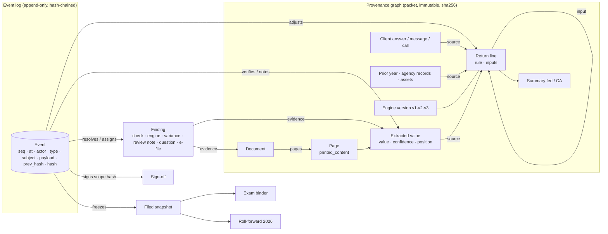

# Core idea: a workpaper is a provenance graph plus an append-only event log

A workpaper exists to prove a return: where every number came from, what was done to it, who checked it, and what is still open. Someone who had never seen a paper workpaper would not draw a grid for that. They would draw **claims and their evidence**, and keep **a ledger of every judgment**.

**1. The provenance graph (facts, immutable).** Every number is a claim with a chain behind it: *document page → extracted value (confidence, position) → return line (rule, inputs) → summary*. The graph is built from the packet exactly as delivered. Its sha256 is recorded at the start of every workspace, so anyone can prove which data the workpaper was built from. Trace goes down the graph, and "everywhere this document landed" goes up it. Prior years, agency records, client answers and messages are nodes too. The independent checks walk the graph looking for contradictions (31 generic rules). Nothing is a hardcoded answer.

**2. The event log (judgments, append-only).** Every human act is one immutable, hash-chained event: who, when (season time and wall time), what, about which node, and why. Adjustments keep the original value. Verifications name their type. Questions and answers become evidence nodes. Sign-offs store the hash *and* a snapshot of what was signed. Approvals, e-file results, freezes and amendments are all events. Undo is an event too ("ignore batch X"). SQLite triggers reject UPDATE and DELETE.

**3. Everything else is a projection** of graph + log "as of" a moment: *fold(events ≤ t) ⊕ packet facts available at t*.

| Requirement | Falls out as |
|---|---|
| Trace any number; doc → everywhere it landed | walk the graph down / up |
| "Our" return without rerunning the engine | engine values + overrides, with arithmetic rules recomputed and the rest marked *stale* |
| Tax effect of a change | Δ at category anchors × published rates; engine what-if where it exists; labeled *estimate* |
| Sign-off reopens on change | the stored hash ≠ the hash of the same scope now; the snapshot diff says what changed |
| Replay the season, compare versions | fold to any t; v1/v2/v3/ours are just different bases |
| Freeze at filing, amend on top | a content-addressed snapshot; afterwards only an amendment layer accepts events |
| Notice response years later | a binder rendered from the snapshot + evidence pages + event hashes |

## Data model

**Event types** (the domain language): `adjustment.created/approved/rejected/reverted` · `verification.recorded` · `note.added` · `finding.status/assigned/resolved` · `review_note.created` · `question.asked/answered` · `signoff.recorded/reopened` · `judgment.recorded` · `due_diligence.recorded` · `filing.approval_requested/client_approved/transmitted/result/frozen` · `amendment.opened` · `season.clock/scripted` · `standards.updated` · `unmask.viewed` · `batch.undone/redone` · `evidence.attached` · `time.logged` · `assignment.set`.

**Documents sit behind an interface.** `DocumentSource.locate(extractedValue) → {page, box, span}` and `renderPage(page, highlights)`. Today the source is simulated from `printed_content`, with the exact span highlighted and the extraction box shown on a page map. Upload a scan or PDF for the same document id and a `FileDocumentSource` takes over. The same trace links keep working, and the boxes become real.
